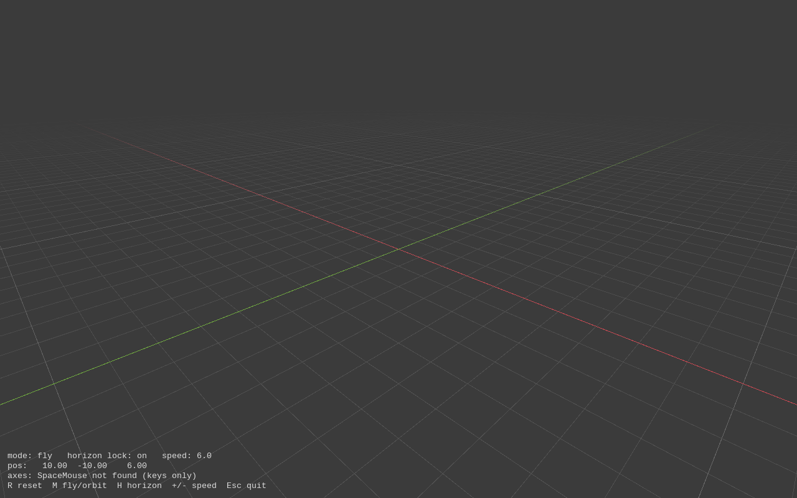
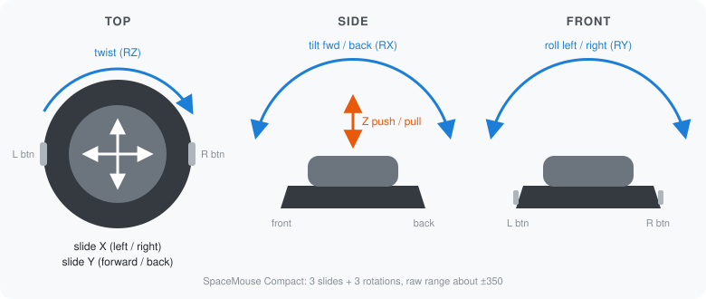

# spacemouse-test

Playing with a 3Dconnexion SpaceMouse Compact on Linux, in plain Python. No drivers, no `spacenavd`: the kernel already exposes the puck as an input device, and this reads it directly.

It's a test bed for a small reusable library, plus a couple of toys built on it.



## The puck

Six axes (three slides, three rotations) and two buttons:



## What's here

| File | What it does |
|------|--------------|
| `src/spacemouse.py` | The library part. Finds the device, reads axes and buttons without blocking. |
| `src/camera.py` | Turns axes into camera motion: deadzone, response curve, fly and orbit modes. |
| `src/cli_axis_viewer.py` | Live bars for each axis in the terminal. Good first check. |
| `src/grid_viewer.py` | Blender-style floor grid you fly around with the puck. |
| `src/mouse_mode.py` | Use the puck as a regular mouse while it runs. |
| `70-spacemouse.rules` | udev rule so your user can read the device. |

## Setup

```bash
# Python deps
pip install evdev pyglet

# Let the logged-in user read the puck (one time)
sudo cp 70-spacemouse.rules /etc/udev/rules.d/
sudo udevadm control --reload-rules && sudo udevadm trigger
```

The rule has to be numbered below 73, or it runs after systemd grants access and does nothing.

## Run

```bash
python src/cli_axis_viewer.py   # terminal readout
python src/grid_viewer.py       # 3D grid
python src/mouse_mode.py        # mouse mode, Ctrl+C to stop
```

### Grid viewer

| Input | Fly mode | Orbit mode |
|-------|----------|------------|
| Slide left / right | Strafe | Pan sideways |
| Slide forward / back | Move along the view | Zoom in / out |
| Push / pull | Down / up | Pan up / down |
| Tilt, twist | Look around | Orbit the pivot |
| Left button | Reset view | Reset view |
| Right button | Switch to orbit | Switch to fly |

Keys: `R` reset, `M` fly/orbit, `H` horizon lock (keeps the floor level; ignores roll), `+`/`-` speed, `Esc` quit.

If an axis feels backwards, flip its entry in `SIGNS` at the top of `src/camera.py`.

### Mouse mode

Slide moves the cursor, twist scrolls, the buttons are left and right click. It creates a virtual mouse through `/dev/uinput`, so it works in any app. Needs write access to `/dev/uinput`; Steam's udev rules already grant it, otherwise add a `uaccess` rule for it.

## Using it from other code

```python
from spacemouse import SpaceMouse, find_device

mouse = SpaceMouse(find_device())
while True:
    pressed = mouse.poll()       # call once per frame
    x, y, z, rx, ry, rz = mouse.axes
```

Raw values run about ±350. `camera.shape()` maps them to -1..1 with a deadzone.
